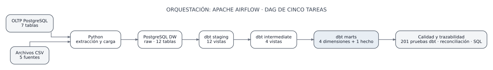
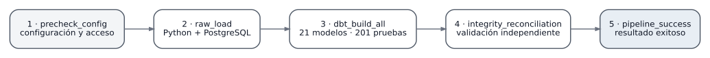
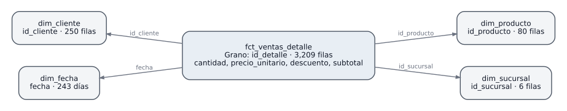

# Arquitectura de la solución SG-Food

## Vista general

SG-Food implementa una arquitectura ELT desacoplada en la que **Python** extrae datos de PostgreSQL OLTP y CSV, **PostgreSQL** conserva la información original y sirve el Data Warehouse, **dbt Core** aplica transformaciones analíticas y **Apache Airflow** coordina el proceso y su validación. La separación por roles y esquemas permite distinguir lectura de fuentes, escritura en raw y construcción de modelos.

[Fuente editable draw.io](diagramas/01-arquitectura-elt.drawio)

## Componentes y responsabilidades

| Capa | Componentes | Responsabilidad |
|---|---|---|
| Origen transaccional | PostgreSQL `sgfood_oltp`, esquema `oltp_sgfood` | Siete tablas de la operación de ventas |
| Origen de archivos | Cinco CSV en `data/` | Inventario, devoluciones, metas, promociones y proveedores/precios |
| Ingesta | `etl/raw_loader.py` | Validación, extracción, trazabilidad y escritura transaccional |
| Persistencia de origen | `sgfood_dw.raw` | Doce tablas físicas y metadatos de carga/procedencia |
| Transformación técnica | `staging` (12 vistas dbt) | Conversión y normalización de tipos, columnas y esquemas |
| Transformación de negocio controlada | `intermediate` (4 vistas dbt) | Enriquecimiento y agregaciones sin alterar granos originales |
| Consumo dimensional | `marts` (5 vistas dbt) | Cuatro dimensiones y el hecho `fct_ventas_detalle` |
| Orquestación | `dags/sgfood_elt_integral.py` | Secuencia, dependencias y estados de ejecución |
| Calidad | Tests dbt, reconciliación Python, SQL analítico | Unicidad, no nulidad, relaciones, conservación y cobertura |

El servicio PostgreSQL de metadatos de Airflow es independiente del OLTP y del DW; no es una fuente del dominio comercial.

## Flujo extremo a extremo

1. El DAG comprueba las variables, rutas, ejecutables, directorios y accesibilidad de las conexiones.
2. Python extrae las siete entidades OLTP, lee los cinco CSV y carga doce tablas `raw` dentro de una operación transaccional controlada.
3. `dbt build` construye **12 modelos staging, 4 intermediate y 5 marts** y ejecuta **201 pruebas** declaradas en el proyecto.
4. La reconciliación Python compara contenido y conteos entre OLTP, archivos y raw, así como integridad, preservación del grano y cobertura del modelo dimensional.
5. El marcador terminal del DAG se ejecuta solo cuando las etapas anteriores culminan exitosamente.

[Fuente editable draw.io](diagramas/02-dag-airflow.drawio) · [Implementación y evidencias](16-airflow-infraestructura.md)

## Modelo dimensional implementado

El mart publica cuatro dimensiones (`dim_cliente`, `dim_fecha`, `dim_producto`, `dim_sucursal`) y un hecho (`fct_ventas_detalle`). El **grano** del hecho es una fila por `id_detalle` de venta; su fecha, cliente y sucursal proceden de la cabecera, mientras que producto, cantidad, precio, descuento y subtotal proceden del detalle. Las relaciones lógicas utilizan `id_cliente`, `id_producto`, `id_sucursal` y `fecha`.

[Fuente editable draw.io](diagramas/03-modelo-dimensional.drawio) · [Detalle del hecho](11-dbt-marts-ventas-detalle.md)

Las cinco entidades del mart son **vistas dbt**; PostgreSQL no admite PK/FK físicas sobre estas vistas ordinarias. La unicidad, integridad y ausencia de multiplicación de filas se verifican mediante tests SQL/dbt y reconciliación.

## Decisiones de diseño

- **ELT y separación de capas.** `raw` conserva valores y metadatos de las fuentes; el tipado y la conformación analítica se ejecutan después de la carga.
- **Grano estable.** Las devoluciones, inventario y metas se modelan como información complementaria; no se unen indiscriminadamente al hecho de detalle de ventas.
- **Medidas de origen.** `subtotal` se conserva y reconcilia tal como figura en la fuente; no se reconstruye con una fórmula comercial no aprobada.
- **Inventario histórico.** El estado de vencimiento se calcula respecto de `fecha_corte` de cada registro, no respecto de la fecha actual ni del último corte.
- **Materialización mediante vistas.** Los 21 modelos dbt utilizan vistas para hacer explícito el linaje y centralizar transformaciones; los controles de relación se ejecutan como pruebas.
- **Privilegio mínimo.** Tres roles operativos delimitan lectura OLTP, escritura raw y construcción/consulta dbt; las contraseñas se mantienen en `.env` local.
- **Ejecución controlada.** El DAG es manual, estrictamente secuencial y no tiene reintentos automáticos; se evitan escrituras concurrentes no controladas con `max_active_runs=1`.

## Evidencia y límites

Las dos ejecuciones Airflow registraron cinco tareas `success`, 21 modelos, 201 tests y reconciliación con código 0; [evidencias 37 y 38](../resultados/37-airflow-3c3-primera-ejecucion.txt). La [evidencia 39](../resultados/39-airflow-3c3-idempotencia.txt) verifica igualdad observacional de 17 objetos. Las [consultas analíticas](../sql/05-consultas-analiticas.sql) y la [evidencia 40](../resultados/40-validacion-consultas-analiticas.txt) respaldan la conservación de 3,209 filas del hecho.

No se implementó historización SCD tipo 2, atribución comercial de promociones a las ventas ni dashboard; tampoco se ensayó una restauración limpia del DDL exportado. Estas son limitaciones expresas, no tareas incompletas del flujo validado.
