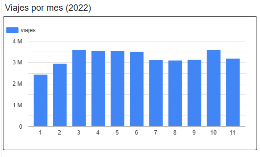
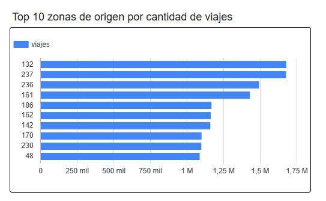
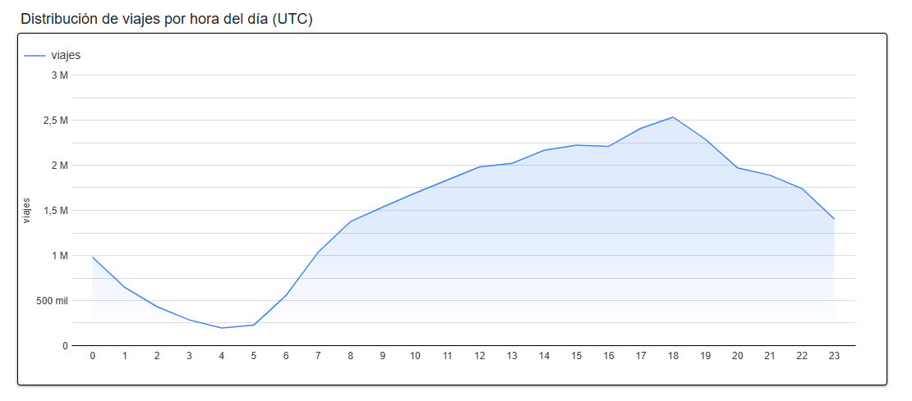
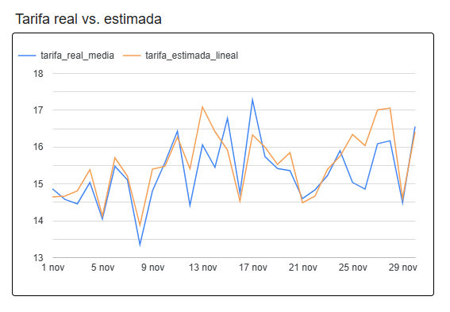
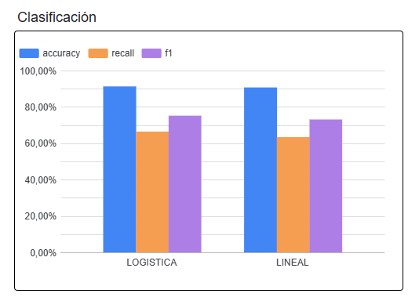
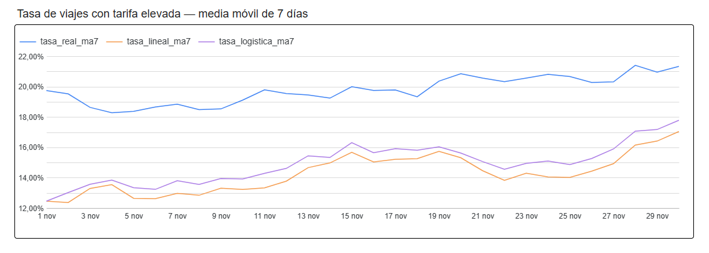
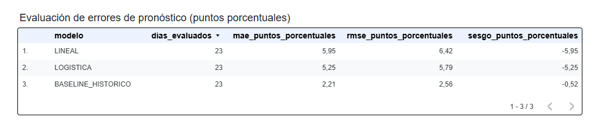
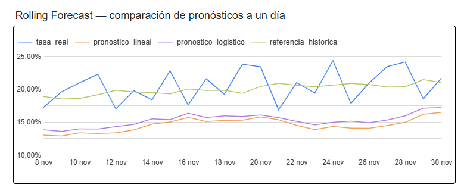

# Informe interactivo de resultados

**Proyecto:** NYC Taxi Trips 2022 — Grupo 6

**[Dashboard en Data Studio / Looker Studio](https://datastudio.google.com/reporting/45e788e9-a2c3-4606-8721-4ba456c08a19)**

Diseñamos el informe visual a partir de vistas BigQuery que separan los hallazgos exploratorios, la comparación de modelos y el análisis predictivo temporal. La tabla `resumen_eda_dashboard` reúne 297 agregados para las visualizaciones exploratorias; las métricas y predicciones provienen de resultados ya materializados.

## Página 1. Análisis exploratorio

**Viajes por mes:** la vista `vw_viajes_mes` presenta el comportamiento temporal por `mes_2022`, de enero a noviembre. **Zonas de origen:** `vw_zonas` permite comparar los diez identificadores de zona con mayor cantidad de viajes; se presentan códigos y no denominaciones geográficas. **Distribución horaria:** `vw_horas` representa la actividad de 0 a 23 horas en UTC. Las comprobaciones en BigQuery identificaron 11 meses, 262 zonas de origen y 24 horas.

## Página 2. Evaluación de BigQuery ML

**Tarifa real frente a estimada:** `vw_predicciones_diarias` compara los importes diarios medios de noviembre. **Clasificación:** `vw_comparacion_clasificacion` enfrenta Accuracy, Recall y F1 de las dos tareas binarias comparables. **Media móvil descriptiva:** `vw_rolling_comparativo` representa tasas reales y tasas pronosticadas por viaje suavizadas sobre siete días. Esta última visualización es descriptiva y distinta del Rolling Forecast de la tercera página.

## Página 3. Rolling Forecast con origen móvil

La vista `vw_forecast_origen_movil` muestra la proporción diaria observada junto a tres series pronosticadas: tasa derivada del modelo lineal, tasa derivada de la logística y referencia histórica. La vista `vw_forecast_metricas` registra MAE, RMSE y sesgo en **puntos porcentuales** para los 23 objetivos del 8 al 30 de noviembre de 2022. Las tasas dibujadas como porcentajes se expresan originalmente como valores entre 0 y 1.

La referencia histórica obtuvo el menor error. Los modelos se mantuvieron fijos; el origen del pronóstico avanzó cada día y la fecha objetivo se excluyó de la ventana histórica. No se trató de reentrenamiento diario ni de un pronóstico operativo del volumen total de taxis.

## Evidencia visual disponible

- [Análisis exploratorio](../evidencias/capturas/dashboard_01_exploracion.png)
- [Evaluación BigQuery ML](../evidencias/capturas/dashboard_02_modelos_bqml.png)
- [Rolling Forecast — captura del editor](../evidencias/capturas/dashboard_03_rolling_forecast_editor.png)
